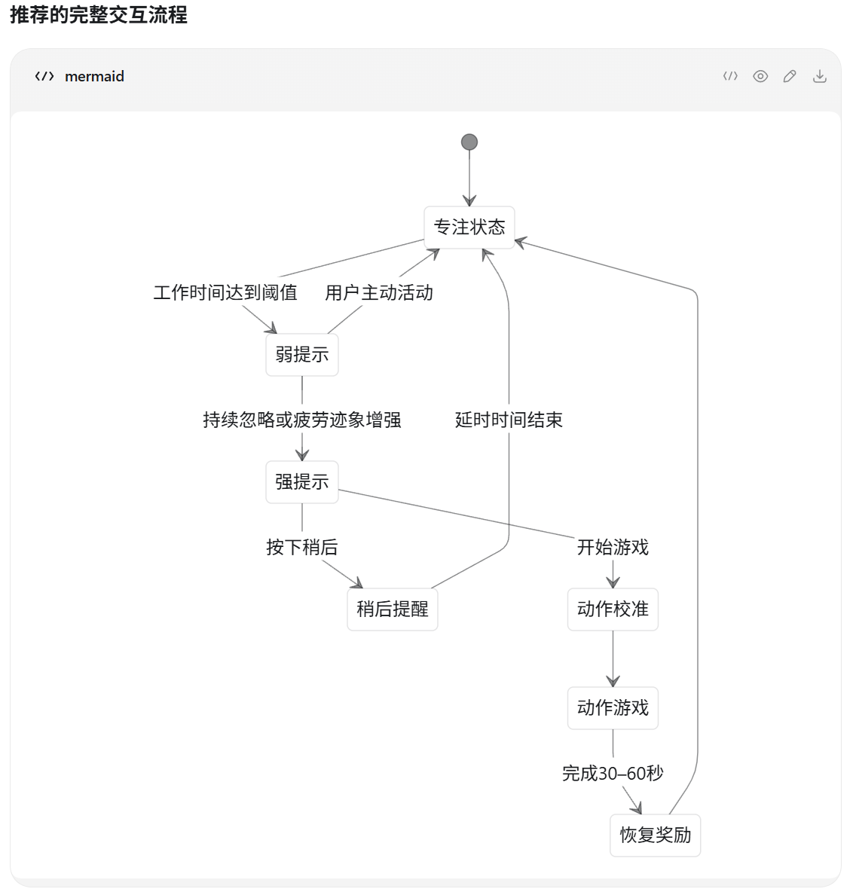
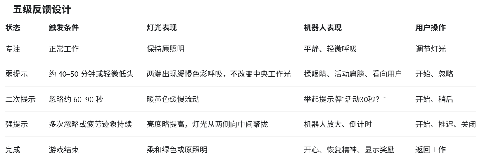
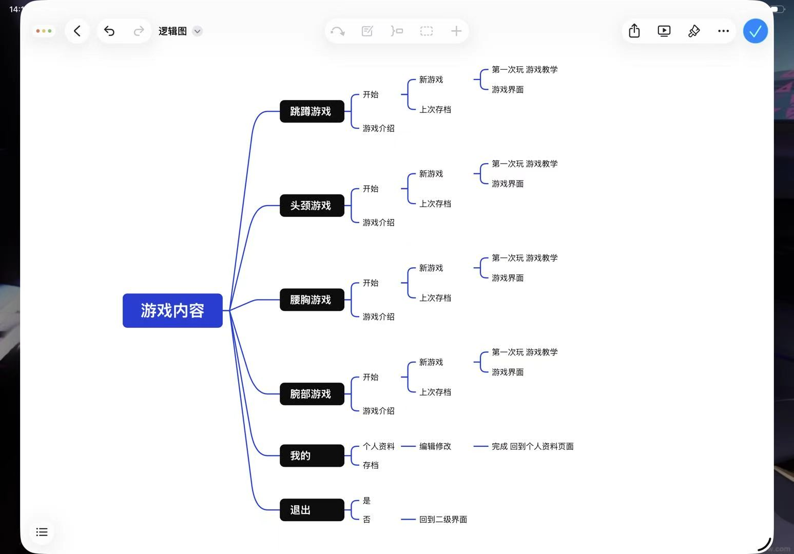
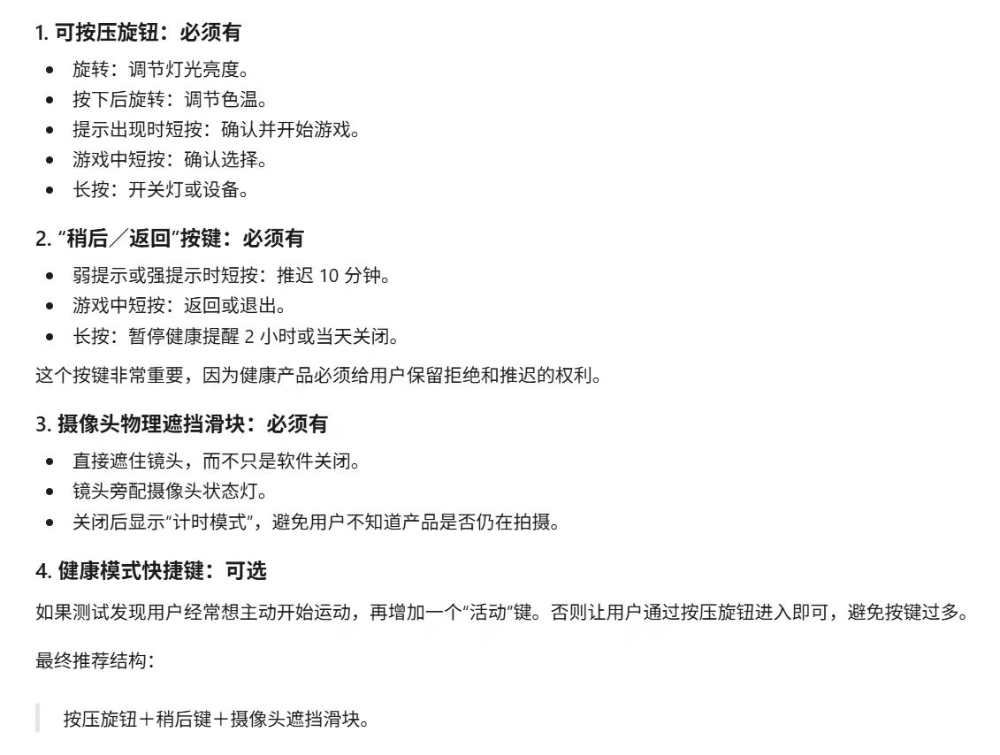

# 课后讨论｜2026\-09\-01｜智能健康产品方案

# 智能健康产品方案讨论

> **关联课程**：第03节｜Processing进阶：变量、数组与计算机视觉（2026\-08\-31，周一）
> **讨论时间**：2026\-09\-01 13:07–13:29
> **性质**：课后项目构思与原型实现讨论；不是课堂结论。
> **原始妙记**：[智能健康产品方案讨论](https://acnprpn2zifw.feishu.cn/minutes/obcnrn2t599kriz88h257s1a)
> 
> 

## 先看这次定下来的方向

为久坐、面对屏幕的人设计一件“机器人结合屏幕挂灯”的智能健康产品。它保留照亮桌面和键盘的基本功能，并在挂灯上加入长条像素屏：日常展示机器人表情；提醒或活动时展示简短交互与轻量小游戏。

本次只确认概念和演示路径。真实硬件、识别精度、摄像头布置和联网模块仍待后续与专业老师讨论，不把它们写成已经解决的技术事实。

## 产品与交互逻辑

### 1\. 为什么选屏幕挂灯

- 相比放在桌上的小摆件，挂在屏幕上方更容易被正在工作的人注意到。

- 它不是纯装饰：照亮桌面和键盘仍是基础功能。

- 长条像素屏用于机器人表情、机器人界面和小游戏；产品希望作为独立设备，不要求用户在原有电脑上额外安装程序。

### 2\. 久坐提醒的两级机制

|阶段|暂定反馈|用户要做什么|
|---|---|---|
|弱提示|灯光颜色或闪烁变化；角落出现机器人表情，可提示喝水、远眺等|收尾手头工作，准备活动|
|强提示|灯光造成可感知的干扰／锁定感|起身或完成指定手势交互，解除灯光影响|

当前演示可采用固定定时，不做用户状态识别或 AI 模型训练：久坐约 30 分钟触发弱提示，约 10 分钟后触发强提示；活动约 5 分钟结束一轮。具体时长仍是待调研参数。

## 小游戏：不是大型体感游戏

游戏的目的不是娱乐时长，而是让用户短时活动肩颈、腰、腿或手腕。可探索的动作与玩法包括：

- 跳跃／下蹲避障的一维跑酷，类似离线小恐龙或简化马里奥；

- 扭腰躲避飞来障碍；

- 手腕画圈或手势操控；

- 后续再把不同身体部位的动作融入不同关卡。

本次讨论提出“景动人不动、镜头锁定角色”：在狭长屏上保持角色相对居中，让背景或取景移动，表现跑动、跳跃和躲避。

## 原型实现路径

1. **优先网页实现。**团队成员对网页更熟悉；不强制使用游戏引擎，只要演示能呈现预期交互即可。

2. **先模拟屏幕。**以约 40×8 cm 的长条比例制作网页或 Processing 模拟，测试文字、角色、动作反馈是否看得清。

3. **先完成一款小游戏。**周一展示只需一个可运行、难度低的游戏，以及喝水／表情等弱提示；不必实现全部身体部位和全部功能。

4. **明确呈现边界。**网页中模拟“电脑＋顶部挂灯”的情境，用阴影或光效让观众知道挂灯才是产品，电脑只是使用场景。

5. **再讨论落地。**如后续做硬件，可考虑低成本联网模块和摄像头，但不在本阶段承诺具体方案。

## 争议与待验证项

- 40×8 cm 左右的狭长屏是否足够清晰，尤其是用户站起来后是否仍能看见游戏反馈。

- 狭长屏能否承载手势／体感游戏；摄像头的视场、识别精度和交互动作范围都尚未验证。

- “独立设备、不干扰电脑”与“直接在电脑上运行游戏”是讨论中的两种思路；当前倾向前者，但应通过原型测试再判断。

- 屏幕挂灯可挂的设备、固定方式及真实硬件落地性，均需后续确认。

## 当前分工与最近节点

- 当日下午约 15:00 前：先输出游戏框架图。

- 开发侧：按框架先熟悉代码并制作一个可演示的轻量游戏。

- 演示侧：完成带产品情境的网页原型，清楚区分电脑和挂灯。

- 9 月 7 日（周一）阶段展示：以“一个小游戏＋弱提示”为最低可演示范围。

## 录音定位

|时间段|内容|
|---|---|
|00:00–04:20|挂灯＋机器人＋像素屏、弱／强提示与健康活动构想|
|05:00–08:40|网页优先、约40×8 cm模拟屏、独立设备构想|
|08:40–16:50|是否占用电脑、狭长屏与体感反馈的讨论|
|17:25–20:25|固定定时规则、游戏方向与周一最小演示范围|
|20:35–22:00|网页呈现方式、框架图与开发安排|

## 原始来源

[智能健康产品方案讨论（obcnrn2t599kriz88h257s1a）](https://acnprpn2zifw.feishu.cn/minutes/obcnrn2t599kriz88h257s1a)｜2026\-09\-01 13:07:33，时长 22 分钟。

## 组员资料整合｜给开发者的产品规格

**开发边界：**你负责的是“挂灯产品屏幕上的系统原型”，不是用户电脑桌面软件。第一版优先做可演示的状态切换、提示、校准和一款小游戏；真实硬件、摄像头识别精度与联网协议后置。

以下四张图均来自组员成果。我已把它们翻译为可开发的页面、状态、事件和参数；未定内容以“待验证”标注，避免代码把讨论中的假设写死。

### 图一｜完整交互状态流



**实现解读：**这是产品级状态机，不是单一游戏流程。主循环是：专注 → 弱提示 → 二次提示／强提示 → 游戏前确认 → 动作校准 → 动作游戏 → 恢复奖励 → 专注。用户主动活动、选择稍后或完成活动，都会改变下一步。

### 图二｜五级反馈设计



|系统状态|开发要呈现的内容|用户可执行动作|
|---|---|---|
|focus|正常照明；机器人平静／轻微呼吸|调灯光|
|weakPrompt|两端色彩呼吸；不遮挡中央工作光；机器人眨眼或活动肩膀|开始活动、忽略|
|secondaryPrompt|暖黄色缓慢流动；显示“活动30秒？”|开始、稍后|
|strongPrompt|亮度／灯光向中间聚拢；机器人放大并倒计时|开始、推迟、关闭|
|reward|柔和绿色或原照明；开心表情和奖励反馈|返回工作|

### 图三｜游戏界面外的一级系统架构



**正确定位：**图三不是“游戏页面的流程图”，而是游戏外的一级信息架构。开发时应先让这些一级入口可点击，再把每款游戏作为独立模块挂入“游戏内容”。

|一级入口|第一版需要实现|暂不必做深|
|---|---|---|
|专注／首页|当前灯光、机器人状态、开始活动入口|复杂数据看板|
|游戏内容|头颈、腰背、腕部、跳蹲四类卡片；先真正做其中一款|四款都完成、多人排行榜|
|新游戏／上次存档|首次教程与“继续演示”两个入口；可用 localStorage 保存当前进度|账号同步|
|我的|本地资料与完成记录占位；支持编辑昵称或清空演示数据|真实账户体系|
|退出／返回|二级页回首页；游戏中退出前确认|多层复杂返回栈|

### 图四｜硬件控制、拒绝权与隐私



- **按压旋钮：**旋转调亮度；按下旋转调色温；提示时短按确认并开始；游戏中短按确认；长按开／关机。

- **稍后／返回键：**弱提示或强提示时短按推迟10分钟；游戏中短按返回／退出；长按暂停健康提醒2小时或当天关闭。

- **摄像头遮挡滑块：**物理遮挡优先于软件设置。遮挡后，界面必须明确显示“计时模式”，并禁用所有依赖摄像头的动作校准与手势输入。

这三个硬件输入在网页原型中可先用屏幕按钮和键盘映射模拟；代码层保持同一套事件名，后续替换成实体按键或串口输入时不重写业务逻辑。

## 开发状态机｜建议直接照此拆组件

|状态|进入事件|核心 UI／效果|离开事件|
|---|---|---|---|
|focus|应用启动、奖励结束、延时结束|正常灯光与待机机器人|TIMER\_WEAK、START\_ACTIVITY|
|weakPrompt|TIMER\_WEAK|呼吸色、低打扰提示|START、IGNORE、SNOOZE|
|secondaryPrompt|IGNORE\_WINDOW\_ELAPSED|暖色流动、30秒邀请|START、SNOOZE、IGNORE|
|strongPrompt|REPEATED\_IGNORE 或 fatigue flag|更强灯光、放大机器人、倒计时|START、SNOOZE、DISABLE\_TODAY|
|calibration|START|摄像头状态、站位／动作示范、跳过键|CALIBRATION\_OK、CAMERA\_CLOSED、BACK|
|game|CALIBRATION\_OK 或 DEMO\_MODE|一款体感小游戏与退出键|GAME\_COMPLETE、BACK|
|reward|GAME\_COMPLETE|绿色／恢复照明、奖励与返回工作|RETURN\_TO\_WORK|
|privacyPause|CAMERA\_CLOSED|“摄像头已遮挡；仅保留计时提醒”|CAMERA\_OPENED、BACK|

## 参数冲突｜不要写死，统一放入配置

录音与组员图给出的时间不同：录音用于快速演示，提出“约30分钟弱提示、10分钟后强提示”；图二提出“约40–50分钟弱提示、忽略约60–90秒后二次提示”。它们可以共存为不同模式，最终数值待小组确认。

```ts
const reminderConfig = {
  demo: { weakAfterMin: 1, secondaryAfterSec: 15, snoozeMin: 1 },
  conceptA: { weakAfterMin: 30, strongAfterMin: 10, activityMin: 5 },
  conceptB: { weakAfterMin: 45, secondaryAfterSec: 75, snoozeMin: 10 },
};
```

开发界面必须提供“演示模式”快捷触发；否则真实等待30–45分钟会让课堂展示无法验证状态切换。

## Vibe Coding 开发顺序

1. **先做状态骨架：**用一个状态机或 reducer 管理上述状态；用按钮触发事件，不接摄像头。

2. **做屏幕语言：**完成专注、弱提示、二次提示、强提示、奖励五种灯光和机器人动画。

3. **做导航壳：**首页、游戏库、我的、返回；图三中的游戏卡片先可进入同一款 Demo。

4. **做一款游戏：**优先一维跳蹲／避障；先支持键盘或鼠标，后用独立的 gesture adapter 替换输入。

5. **最后接摄像头：**先做“摄像头开／关、遮挡、校准成功／失败”状态，不承诺完整手势识别；隐私遮挡时自动退回非视觉模式。

## 第一版验收清单

- 不等真实时间，也能在演示模式走完 focus → 提示 → 校准 → 游戏 → 奖励 → focus。

- “稍后”“返回”“关闭当天”不会卡死状态，且能恢复到正确的专注页面。

- 图三的一级入口可点击；至少一款游戏可完整进入、退出和完成。

- 摄像头遮挡后，游戏／校准入口显示不可用原因，不假装仍在采集。

- 电脑只是产品情境；视觉上始终突出顶部挂灯及其长条屏，而不是把网页误解成电脑端健康软件。

